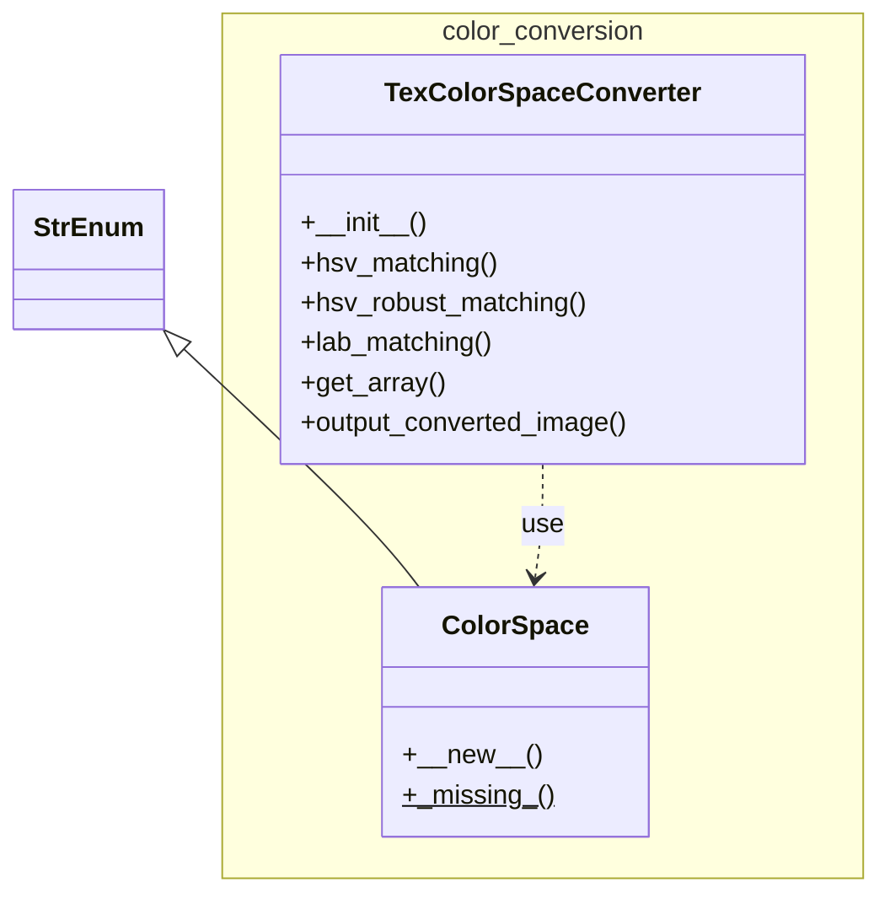

# texture-generator

Provides the modules to procedurally generate texture images.  
This repositroy is the submodule for
*  [TextureGenerator](https://github.com/taKana671/TextureGenerator)
*  [sky-archipelago](https://github.com/taKana671/sky-archipelago)

# Class Diagram

## Various texture generators

```mermaid
classDiagram  
  class NoiseProcessMixin{
    <<mixin>>
    +round_num()
    +round_arr()
    +adjust_noise_amount()
    +reshape_noise_peak()
    +clip_array()
  }
  
  namespace heightmap_generator{
    class ProcessHeightmapMixin{
      <<mixin>>
      +reshape_noise_peak()
      +create_bw_texture_map()
      +generate_contour_vertices()
    }
    
    class RockPillarsHeightmap{
        +\_\_init\_\_()
        +convert_to_ksize()
        +generate_heightmap()
        +output_heightmap()
        +write_to_file()
    }

    class _VoronoiNoiseRockPillars_{
        <<abstract>>
        +\_\_init\_\_()
        +*generate_noise*()
        +output_heightmap()
        +create_heightmap()
    }

    class VoronoiRockPillarsHeightmap{
        +\_\_init\_\_()
        +generate_noise()
    }

    class RoundedVoronoiRockPillarsHeightmap{
        +\_\_init\_\_()
        +generate_noise()
    }

    class IslandHeightmap{
      +\_\_init\_\_()
      +from_sfractal(cls)$
      +from_pfractal(cls)$
      +output_heightmap()
      +create_heightmap()
      +get_height()
      +generate_heightmap()
    }

    class Masking{
      +composite()$
      +fractal_simplex_noise()$
      +fractal_perlin_noise()$
    }
  }

  namespace texture_generator{
    class Cloud{
      +\_\_init\_\_()
      +\_convert()
      +from_file(cls)$
      +from_vfractal(cls)$
      +from_pfractal(cls)$
      +from_sfractal(cls)$
      +create_cloud_image()
      +create_cloud_cover()
      +define_src_pts()
      +perspective_transform()
      +create_background()
      +composite()
    }

    class CubeMap{
      +\_\_init\_\_()
      +from_vfractal(cls)$
      +from_sfractal(cls)$
      +from_pfractal(cls)$
      +create_cubemap()
      +create_skybox_images()
    }

    class SphereMap{
      +\_\_init\_\_()
      +from_sfractal(cls)$
      +create_spheremap()
      +create_skysphere_image()
      +create_cubemap()
      +create_skybox_images()
      +rotate()
      +create_coords_group()
      +convert_equirectangular()
      +remap_equirectangular()
      +convert_sphere_to_cube()
      +generate_images()
    }
  }

　namespace mask{
    class LinearGradient{
    　+\_\_init\_\_()
    　+get_gradient_2d()
    　+get_gradient_3d()
    　+output_image()$
    }

    class HorizontalGradientMask{
    　+\_\_init\_\_()
    　+output_image()$
    }

    class TransparentHorizontalGradientMask{
    　+\_\_init\_\_()
    　+output_image()$
    }

    class VerticalGradientMask{
    　+\_\_init\_\_()
    　+output_image()$
    }

    class TransparentVerticalGradientMask{
    　+\_\_init\_\_()
    　+output_image()$
    }

    class RadialGradient{
      +\_\_init\_\_()
      +get_distance()
      +get_gradient()
      +get_gradient_array()
      +output_image()$
    }    

    class RadialGradientMask{
    　+\_\_init\_\_()
    　+output_image()$
    }

    class TransparentRadialGradientMask{
    　+\_\_init\_\_()
    　+output_image()$
    }

    class ShapeMask{
    　+\_\_init\_\_()
    　+create_bg_image()
    　+blur()
    　+change_rgb_to_bgr()
    }

    class Circles{
    　+create_circle()
    　+output_image()$
    }

    class CircleMask{
      +\_\_init\_\_()
      +create_circle()
      +output_image()$
    }

    class TransparentCircleMask{
      +\_\_init\_\_()
      +create_circle()
      +output_image()$
    }

    class Lines{
      +create_lines()
      +output_image()$
    }

    class LineMask{
      +\_\_init\_\_()
      +create_lines()
      +output_image()$
    }

    class TransparentLineMask{
      +\_\_init\_\_()
      +create_lines()
      +output_image()$
    }
　}

  namespace noise_compositing{
    class FractalNoiseBlending{
      <<abstract>>
      +\_\_init\_\_()
      +*blend*()
      +blend_fractal()
      +get_source_array()
      +get_noise_array()
      +output_image()
    }

    class PerlinNoiseBlending{
      +\_\_init\_\_()
      +blend()
    }

    class SimplexNoiseBlending{
      +\_\_init\_\_()
      +blend()
    }
  }  

  NoiseProcessMixin <|-- RockPillarsHeightmap 
  RockPillarsHeightmap <|-- _VoronoiNoiseRockPillars_
  _VoronoiNoiseRockPillars_ <|-- VoronoiRockPillarsHeightmap
  _VoronoiNoiseRockPillars_ <|-- RoundedVoronoiRockPillarsHeightmap

  NoiseProcessMixin <|-- Cloud
  NoiseProcessMixin <|-- CubeMap
  NoiseProcessMixin <|-- SphereMap

  ShapeMask <|-- Circles
  Circles <|-- CircleMask
  Circles <|-- TransparentCircleMask

  LinearGradient <|-- HorizontalGradientMask
  LinearGradient <|-- TransparentHorizontalGradientMask
  LinearGradient <|-- VerticalGradientMask
  LinearGradient <|-- TransparentVerticalGradientMask

  RadialGradient <|-- RadialGradientMask
  RadialGradient <|-- TransparentRadialGradientMask

  NoiseProcessMixin <|-- IslandHeightmap
  IslandHeightmap ..> RadialGradientMask : create and use
  Cloud ..> LinearGradient : create and use
  CubeMap ..> Cloud : create and use
  SphereMap ..> Cloud : create and use

  ShapeMask <|-- Lines
  Lines <|-- LineMask
  Lines <|-- TransparentLineMask

  NoiseProcessMixin <|-- FractalNoiseBlending
  FractalNoiseBlending <|-- PerlinNoiseBlending
  FractalNoiseBlending <|-- SimplexNoiseBlending

```

## Texture color conversion

# Module Structure

| Dir | File Name | Included Classes |
| :--- | :--- | :--- |
| `utils` | `noise_process_mixin.py` | `NoiseProcessMixin` |
| `heightmap_generator` | `heightmap_processing.py` | `ProcessHeightmapMixin` |
| `heightmap_generator` | `rock_pillars_heightmap.py` | `RockPillarsHeightmap`, `VoronoiNoiseRockPillars`, `VoronoiRockPillarsHeightmap`, `RoundedVoronoiRockPillarsHeightmap` |
| `heightmap_generator` | `island_heightmap.py` | `IslandHeightmap` |
| `heightmap_generator` | `masking.py` | `Masking` |
| `texture_generator` | `cloud.py` | `Cloud` |
| `texture_generator` | `cubemap.py` | `CubeMap` |
| `texture_generator` | `spheremap.py` | `SphereMap` |
| `mask` | `linear_gradient_generator.py` | `LinearGradient`, `HorizontalGradientMask`, `TransparentHorizontalGradientMask`, `VerticalGradientMask`, `TransparentVerticalGradientMask` |
| `mask` | `radial_gradient_generator.py` | `RadialGradient`, `RadialGradientMask`, `TransparentRadialGradientMask` |
| `mask/shapes` | `shape_mask.py` | `ShapeMask`|
| `mask/shapes` | `circle_generator.py` | `Circles`, `CircleMask`, `TransparentCircleMask` |
| `mask/shapes` | `line_generator.py` | `Lines`, `LineMask`, `TransparentLineMask` |
| `noise_compositing` | `fractal_noise_blending.py` | `FractalNoiseBlending`, `PerlinNoiseBlending`, `SimplexNoiseBlending` |
| `color_conversion` | `color_space.py` | `ColorSpace`, `TexColorSpaceConverter` |

